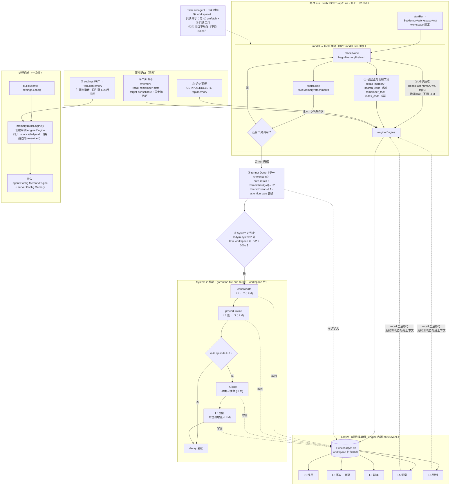

# woca × LadyM 事实记忆库集成设计

- 日期：2026-08-15
- 状态：待用户 review
- 依赖：[LadyM](https://github.com/ProjAnvil/LadyM) Go 重写版 v0.3.0（本地 `~/Documents/codebase/projanvil/ladyM`，commit 4526369）
- 前置调研：本文件自带（见 §16 备选方案与 §9 调研依据）

## 0. 已拍板的决策（用户确认）

| # | 决策 | 内容 |
|---|---|---|
| D1 | 集成路径 | **路径 2：in-process SDK**。woca 直接 import LadyM Go module，进程内单例 `*engine.Engine`。不用 MCP 子进程，不用 LadyM 的 langgraph 图节点 |
| D2 | DB 位置 | 单一 `~/.woca/ladym.db`（不塞进 woca.db，LadyM 自管 schema/迁移），**workspace 作为 memories 表行级隔离字段** |
| D3 | workspace 映射 | woca 的 run workspace（web session 的 workspace 字段，缺省为服务 workdir）→ LadyM engine workspace，同字符串透传 |
| D4 | 接口形状 | 新增窄接口 `MemoryEngine`，不硬套现有 `store.Store`（KV）；KV memoryStore 原样保留 |
| D5 | subagent 记忆 | 调研结论见 §9，**建议只读共享**（本 spec 按"只读共享 + 任务事件"设计，review 时确认） |
| D6 | 记忆面板 | 聊天记录上方 title bar 加入口，workspace 级记忆查看/搜索/增删（§11） |
| D7 | 设置 | settings 页新增"记忆"区；`memory-engine` 默认 `ladym`；embedding/LLM 默认继承 woca 配置；**保存后实时生效**（§5） |

## 1. 背景与目标

woca 目前的事实记忆是 `internal/store` 的 KV memoryStore + `internal/agent/memorystore.go` 的朴素关键词 prefetch：全量 List + 关键词包含匹配，无语义检索、无自动写入（`docs/agent-loop-comparison.md` §6 标注的 extractMemories 缺口）、subagent 完全不带记忆、web 无记忆管理界面。

LadyM（同作者、同 `projanvil/langchain-golang v0.5.0` 依赖、同 modernc sqlite）提供：两级语义检索（HyMem）+ ACT-R 激活排序、attention-gated 写入、L1-L6 分层与 consolidate/proceduralize、代码符号索引。两者工具类型（`core/tools.Tool`）完全一致。

**目标**：把 LadyM 作为 woca 的事实记忆库——

1. 每 run 自动语义召回并注入（替换关键词 prefetch）
2. 每 run 自动沉淀事实（补 extractMemories 缺口）
3. agent 可主动 recall/remember/search_code/index_code
4. subagent 只读共享 workspace 记忆 + 任务事件沉淀
5. settings 页可配置（默认继承 woca），实时生效
6. web 记忆面板：title bar 入口，按 workspace 查看/搜索/增删

**非目标（本期不做）**：MCP 路径（`--mcp ladym=...` 现状已可用，不专门集成）；MEMORY.md/CLAUDE.md 注入改造；代码索引自动化（只提供 `index_code` 工具与命令，不自动跑）；System 2 的 L5/L6 可视化；KV memoryStore 移除。

## 2. 总体架构

```
cmd/woca/main.go ── buildAgent() ──┐
   │  settings.Load()              │
   │  memory.BuildEngine(cfg) ─────┼─▶ internal/memory（新包）
   │        │                       │     ├─ MemoryEngine 接口（agent 依赖它，不依赖 ladyM）
   │        ▼                       │     ├─ ladymAdapter（实现接口，包 ladyM SDK）
   │  *engine.Engine 单例 ──────────┘     ├─ BuildEngine/Resolve*（settings→ladyM Config）
   │                                       └─ noop 引擎（memory-engine=none / 构建失败降级）
   ▼
internal/agent
   ├─ Config.MemoryEngine MemoryEngine（新字段，与 Config.Memory 并存）
   ├─ memorystore.go：prefetch 改走 engine.Recall（engine 非 nil 时）
   ├─ memorytools.go（新）：4 个工具
   └─ runner 完成钩子：auto-retain（Remember + RecordEvent）
```

- 新包 `internal/memory`：接口、LadyM 适配器、构建/继承解析、降级。agent 包只依赖接口，便于测试。
- engine 进程内单例，goroutine 安全（LadyM engine 自带 `sync.Mutex`，storage 有 WAL 并发测试），并发 run 共享。
- LadyM `Config` 由 woca **纯代码构造**（不调 `ladym.DefaultConfig()` 走的 TOML/LADYM_* 环境变量链，避免 cwd 相对路径 `ladym.db` 与环境变量泄漏；唯一例外是初始结构可从 `config.Default()` 取默认值后**逐一覆盖** woca 关心的字段，DBPath/Workspace/Provider/Model 等必须显式赋值）。

### 2.1 触发时机全景图



编号说明：① 每 model turn 自动读（不调 LLM）② 模型主动调工具 ③ run 完成自动写 ④ run 完成后节流整理（花 LLM）⑤ 配置保存实时重建 ⑥ 用户手动（面板/命令）。

## 3. 数据布局与 workspace

- DB：`~/.woca/ladym.db`（settings 键 `ladym-db-path` 可改，支持 `~` 展开）。LadyM 自建五表 + 向量 BLOB；WAL 开启（默认），与 `ladym serve`/`ladym worker` CLI 并行访问兼容。
- workspace 字符串 = run workspace 原样（web：session workspace ?? server workdir 绝对路径；TUI/REPL：workdir 绝对路径）。与 web session 分组（`index.json` 侧车）同一标识，天然对齐"每个 workspace 的聊天都能看这个 workspace 的记忆"（D6）。
- engine 单例 + `Recall(query, workspace, ...)` 按调用传 workspace——**不是**每 workspace 一个 engine（LadyM RetainNode 的短生命周期 engine 模式仅为其 Python 对齐物，woca 不采用；单 DB 行级隔离更省连接）。

## 4. Agent 集成

### 4.1 引擎注入与 per-run workspace

- `agent.Config` 新增 `MemoryEngine memory.Engine`；`Agent` 存私有字段 + mutex（无 setter；热更新走整引擎换指针，见 §5.4）。
- per-run workspace 沿用 `SetObsRun` 先例：`Agent.SetMemoryWorkspace(ws string)`（mutex 保护）。**实施修订（2026-08-15，ctx 值方案落地）**：run 级 workspace 改经 context 值传递（`agent.WithMemoryWorkspace(ctx, ws)`，见 `internal/agent/memws.go`），并发 run 下无竞争——resolve 顺序为 **ctx 值 → agent 字段（TUI/REPL 启动 pin、subagent fork 继承）→ workdir**。web `startRun`/`startGoalRun` 在构造 run ctx 时包裹 session workspace（值在 `context.WithoutCancel` 与取消后均存活，runner defer 的 RetainRun、graph 内的 prefetch、记忆工具全部读到同一 workspace）；agent 字段保留为 TUI 回退层，`SetMemoryWorkspace`/`MemoryWorkspace()` 语义不变。serve 模式下 auto-retain/prefetch 与记忆面板（按 session workspace 查询）现在一致。
- 查询语料：最后一条 Human 消息文本（截 2000 字符），替代现 `memoryTerms` 关键词提取（KV 路径保留原逻辑）。

### 4.2 读路径（prefetch 替换）

`internal/agent/memorystore.go`：

- `beginMemoryPrefetch`：`MemoryEngine != nil` 时异步 goroutine 调 `engine.Recall(ctx, query, runWorkspace, topK)`（topK=settings `ladym-topk`，默认 6）；KV 路径原样保留（engine=nil 时）。
- `takeMemoryAttachments`：注入格式沿用 `<relevant-memory>`，条目渲染升级为：

  ```
  <relevant-memory>
  [L2|fact|0.83] auth 使用 JWT，24h 过期
  <content 截断 2000 字符>
  </relevant-memory>
  ```

  每 run 上限沿用 `maxMemoryAttachments=5`；去重沿用 `injectedMemoryLimit` 机制（按 memory ID）。
- Recall 错误：记日志、跳过注入，不 fallback 到 KV（避免双系统交叉污染）。

### 4.3 写路径（auto-retain，extractMemories 对齐）

单一 choke point：`internal/runner/runner.go` 的 Done 步（web 与 TUI 都经 runner 驱动；subagent 走 `Invoke/Stream` 不经 runner，天然不触发）。条件：engine 非 nil && settings `ladym-autoretain`（默认 true）&& 最终 AI 文本非空。

1. `engine.Remember(ws, "Q: {本 run 的请求}\nA: {最终 AI}", tags=["woca","auto"], metadata={session_id, workspace}, source="woca:auto")` → LadyM attention gate 自动去噪去重（dedup 窗口 1h）。注：runner 入参 history 是整个会话历史，Q 取**最后一条非合成 human 消息**（跳过 `<relevant-memory>`/`<queued-user-input`/`<stop-hook>`/`<task-fork>` 包装），即本 run 的真实请求。
2. `engine.RecordEvent(agent="woca", action="run", observation={请求截 500 字}, outcome="success"|"cancelled"|"error")` → L1 episodic，喂 consolidate/L3/L5/L6。`context.Canceled` 记为 "cancelled"（与 web 侧 cancelled 语义对齐），不混入 error。

### 4.4 工具面（internal/agent/memorytools.go，新文件）

不复用 LadyM `langgraph.CreateTools`（其 workspace 在创建期固化，woca 需要 per-run）；按其模式用 `coretools.FromFunc` 自建 4 个工具，workspace 从 agent 当前 run workspace 解析：

| 工具 | 行为 | 权限分类（internal/tools/registry.go `categoryByName`） | subagent 可用 |
|---|---|---|---|
| `recall_memory` | `engine.Recall(query, ws, top_k)`，输出 `[layer\|type\|score] summary` 行 | CatRead | ✅ |
| `search_code` | `engine.SearchCode(query, top_k, ws)` | CatRead | ✅ |
| `remember_fact` | `engine.Remember(..., source="woca:tool")`，回显 `stored id=... gate=...` | CatWrite | ❌（filterTools 排除） |
| `index_code` | `engine.IndexCode(workdir, force, ws, nil)`，回显索引报告 | CatWrite | ❌ |

注册位置：`agent.New()` 工具组装序列（agent.go:349-362）taskTools 之后；`newSubagent`（agent.go:1107）按上表过滤。

### 4.5 后台运行（System 2 整理与 decay）——运行级别

**运行级别总表**（明确回答"workspace 级还是项目级"）：

| 层 | 级别 | 说明 |
|---|---|---|
| 存储 | **项目级**（整个 woca 进程一份） | 单一 `~/.woca/ladym.db`，所有 workspace 共库，workspace 仅为 memories 行级隔离字段（§3） |
| 引擎 | **项目级**（进程内单例） | prefetch / auto-retain / 4 工具 / web API 共用一个 `*engine.Engine`，每次调用传 workspace 参数；并发 run 共享（engine 自带 mutex，§2） |
| System 2 整理（consolidate → proceduralize → L5/L6 → decay） | **workspace 级** | LadyM 的 `RunSystem2Cycle(eng, ws)` 整链按单 workspace 执行，其中 L5/L6 两步自带 episode 门槛（近期 episode < `MinEpisodesToRun`=3 时仅跳过 L5/L6、consolidate/proceduralize/decay 照常，operations/system2.go:38-52）；woca 以 workspace 为单位独立节流触发 |

**触发模式：机会主义 post-run 触发，无常驻 daemon。**

- 挂点复用 auto-retain 的 runner Done choke point（§4.3）：run 完成后，若 settings `ladym-system2=true` 且该 workspace 距上次周期 ≥ `ladym-system2-interval`（默认 300s，进程内 per-workspace 时间戳节流），起 goroutine 调 `operations.RunSystem2Cycle(eng, ws)`。
- 为什么不用 LadyM 原生 `StartSystem2` 常驻 daemon（备选记录见 §14）：它是 per-workspace daemon 且自开独立 worker 引擎——woca 单进程多 workspace 需要维护 stop-channel 注册表并与 §5.4 的引擎重建（60s 延迟关闭）做生命周期联动；300s 间隔 daemon 在 TUI 短命进程里几乎永远不触发；而周期自带原料门槛（consolidate 的 `MinEpisodesToTrigger`、L5/L6 的 `MinEpisodesToRun`），"有新原料才整理"与 post-run 时机天然对齐（无新原料时各步近乎空转）。
- 进程退出兜底：TUI 的 fire-and-forget 周期可能被退出截断——可接受，consolidate/decay 幂等，下次 run 补跑；web 长驻进程可靠。
- 手动触发：`/memory consolidate`（§8）同步跑一次当前 workspace 周期并输出报告。
- 失败处理：周期单项失败记日志即可，不影响 run 与引擎；无常驻故无需熔断（下个触发点自然重试）。
- LLM 成本：`ladym-llm=inherit` 时每个实际执行的周期含模型调用（consolidate 的 ADD/UPDATE/DELETE/NOOP 判定、L5/L6 提取）；默认 `ladym-system2=false` = 零后台用量，开启即知情选择；`ladym-llm=none` 时 L5/L6 自动跳过（LadyM skip-when-no-LLM 契约）。
- decay：包含在周期链内（`RunSystem2Cycle` 末步），不单独设触发器与设置项。

### 4.6 L5 洞察与 L6 预判：后台如何产生、如何被消费

System 2 周期链中 L5/L6 是仅有的两个**需要 LLM** 且**需要 episode 原料门槛**的步骤（门槛见 §4.5 表）。

**L5 洞察（mental model，"woca 对这个工作区的理解"）**

- 输入：workspace 内 L2 的 fact/note + L3 的 playbook/snippet（`abstractable` 白名单，operations/l5.go）。
- 聚类：按 embedding 余弦相似度 ≥ `L5ClusterSimilarity`（0.65）做连通分量聚类；簇内"未被现有 L5 覆盖"的成员 ≥ `L5MinClusterSize`（3）才处理。
- 抽象：LLM 把每簇抽象为**一条**高阶模型 `{"title"（≤8 词）, "model"（1-3 句）}`，存为 L5 记忆；同时建 L4 `abstracts` 边指向各成员——下轮已覆盖成员自动跳过（增量，不重复花钱）。
- 合并：既有 L5 之间相似度 ≥ `L5MergeSimilarity`（0.80）时，每 `L5MergeEveryNCycles`（5）轮合并一次（报告 NewModels/MergedModels）。
- 演化：新旧模型走 supersedes 链，旧模型**退役不删除**（IsRetired 过滤，时间有效性语义）。
- 语义示例：三条"用 Makefile 管理 build""前端用 npm scripts""CI 里调 make" → L5「该项目用 Makefile 作为统一构建入口」。

**L6 预判（forward intent，"woca 预判你接下来要做什么"）**

- 输入：水位线 `l6_last_episode_ts` 之后的**新** L1 episode（上限 `L6MaxEpisodes`=50）——增量消费，不重复处理。
- 预测：LLM 产出 1-5 个 `{intent（具体下一步）, confidence(0-1), horizon_s（有效秒数，默认 `L6HorizonS`=3 天）}`，存为 L6 记忆。
- 过期：每周期先做过期清扫，TTL 到期的预判退役（ExpiredRetired）。
- 语义示例：episode 流"改了 auth middleware → 跑了测试 → 测试红" → 预判「修复失败的测试用例（0.8）」。

**消费路径（关键设计事实）**：recall 的 `layers` 参数为 nil 时**不过滤层**（operations/recall.go:108，woca 的调用形态）——L5/L6 与 L1-L3 全量参与向量检索与 ACT-R 激活排序。因此：

1. **自动进上下文**：prefetch 注入与 `recall_memory` 工具结果中会出现 `[L5|mental_model|0.81] 项目用 Makefile 统一构建` 这样的条目——洞察/预判无需专门机制即进入对话。
2. **面板可见**：`GET /api/memory?layer=L5_mental`（§7）按层拉取，MemoryPanel 独立呈现（§9.4）。
3. **不主动 push**：L6 预判只在面板展示与 recall 命中时出现，不做输入区提示条/弹窗——避免打扰，也收窄 prompt 注入面。

**成本模型**：L5 = 每个新簇 1 次 LLM 调用；L6 = 每周期 1 次；全部只发生在 `ladym-system2=true` 且周期通过门槛时。

## 5. 设置模型与实时生效（D7）

### 5.1 新 settings 键（internal/settings/keys.go 加常量，DB 存下划线形式）

| 键（显示名） | 取值 | 默认 | 生效 |
|---|---|---|---|
| `memory-engine` | `ladym` \| `none` | **`ladym`** | 实时 |
| `ladym-db-path` | 路径 | `~/.woca/ladym.db` | 实时 |
| `ladym-embedding` | `inherit` \| `hashing` \| `openai` \| `ollama` \| `http` | `inherit` | 实时 |
| `ladym-embedding-model` | string | `""`（openai 时落 `text-embedding-3-small`） | 实时 |
| `ladym-embedding-base-url` | URL | `""`（inherit 时取 `openai-base-url`） | 实时 |
| `ladym-embedding-api-key`（secret） | secrets 表 | `""`（inherit 时取 `openai-api-key`） | 实时 |
| `ladym-llm` | `inherit` \| `none` | `inherit` | 实时 |
| `ladym-autoretain` | bool | `true` | 实时（runner 每 run 读） |
| `ladym-topk` | int 1–20 | `6` | 实时 |
| `ladym-system2` | bool | `false`（后台整理开关，机制见 §4.5） | 实时（每 run 读） |
| `ladym-system2-interval` | int ≥60 | `300`（每 workspace 最小触发间隔，秒） | 实时（每 run 读） |

`Apply()` 加枚举/topk 范围校验；`KeyHelp()` 单行文案照现有格式。

### 5.2 继承解析（internal/memory/resolve.go）

- **embedding `inherit`**：woca 侧有 OpenAI 兼容配置（provider=openai 或 openai-base-url 已设或 openai key 已设）→ `openai` embedding（base-url/key/model 按上表继承链）；否则 → `hashing`（离线确定性，记一条 info 日志说明降级）。
- **llm `inherit`**：把 woca 当前活跃模型经 `adapter.WrapChatModel(model, "function_calling")` 注入（consolidate/L5/L6 用；`ModelRouting.Consolidate` 一项即可，LadyM 会为各认知操作复用）；`none` → 纯启发式，L5/L6 自动跳过（LadyM 有 skip-when-no-LLM 契约测试）。
- 注入用 `ladym.NewEngineWithModels(cfg, &adapter.ModelRouting{Embedding: WrapEmbeddings(...), Consolidate: WrapChatModel(...)})`；inherit 且无可用模型时不注入，落 LadyM 自建 provider。

### 5.3 embedding 变更与 re-embed

woca 构造 LadyM Config 时恒置 `EmbeddingAllowDimChange=true`：引擎打开时若 DB 内已存维度与新 provider 维度不同，LadyM 自动 `RebuildVectorIndex + reembedAll`（engine/engine.go:143-146，已验证）。即**换 embedding 无需迁移脚本，只需重建引擎**。大库 re-embed 耗时落在 PUT 处理内（见 5.4 的同步注意），PUT 响应可耗时数秒，前端 save 按钮 loading 态覆盖。

### 5.4 实时生效机制

仿 `RebuildModel` 模式：

- `server.Config` 新增 `RebuildMemory func() error`（main.go 接线：重新 `settings.Load()` → `memory.BuildEngine` → 新旧引擎换指针 → 延迟关旧）。
- 换指针：agent 内 mutex 替换 `a.memEngine`；旧 engine `Close()` 延迟 60s（进行中 run 的 prefetch 最坏拿到 closed engine → Recall 报错 → 已有错误路径静默跳过，不 crash；60s 覆盖常规 run 时长）。
- web：PUT /api/settings 检测到任一 `ladym-*`/`memory-engine` 变化 → 调 `s.rebuildMemory()`；响应 `restart_required=false`，失败写 `apply_error`（如 db path 不可写）。
- TUI：`/settings set ladym-topk 8` → console `Deps.RebuildMemory` → 输出 "takes effect immediately"（复用 `applyModelChange` 的接线与措辞模式，internal/console/settings_cmd.go:87-92）。
- `ladym-autoretain`/`ladym-topk` 等 per-run 读取项不必重建引擎：runner/prefetch 每次执行时从 settings 重读（仿 `refreshDebugLog` 的 per-run 模式）；只有影响引擎构造的键（engine/db-path/embedding*/llm）才走 rebuild。

## 6. subagent 记忆策略（D5）

**调研结论**：

- Claude Code：subagent 完全隔离，无共享 memory store；主 agent 只能经 Task prompt 传上下文，子 agent 学到的东西只以最终回复回流——[官方 subagents 文档](https://code.claude.com/docs/en/sub-agents)、[Hindsight 的批评文章](https://hindsight.vectorize.io/blog/2026/05/06/claude-code-subagents-shared-memory)。
- Letta（MemGPT）：共享 memory block 是其多 agent 核心模式——同一 block 挂多个 agent（含子 agent），读写即时互通——[Letta shared memory 文档](https://docs.letta.com/v1-sdk/memory/shared-memory)、[memory blocks 博客](https://www.letta.com/blog/memory-blocks/)。
- 学术侧（governed shared memory）：多 agent 生产系统需要受治理的共享记忆，而非各自长上下文——[arXiv 2606.24535](https://arxiv.org/html/2606.24535v1)。

**woca 决策（Letta 派 + 写入收口）**：

| 能力 | 主 agent | subagent |
|---|---|---|
| prefetch 自动注入（modelNode） | ✅ | ✅（同一图逻辑自然生效） |
| `recall_memory` / `search_code` | ✅ | ✅ |
| `remember_fact` / `index_code` | ✅ | ❌ |
| auto-retain（runner 钩子） | ✅ | ❌（不经 runner） |
| 事件沉淀 | 每 run RecordEvent | runTask 完成时 `RecordEvent(agent=subagent 名, action=任务描述, outcome=结果摘要)`（P3） |

语义层写入收口在主 agent 与显式工具调用，事件层允许子 agent 汇报——即"读共享、写治理"。subagent fork 时继承父的当前 workspace。

## 7. Web API（internal/server，复用已预留的 Config.Memory 位置）

`server.Config.Memory` 字段类型改为 `memory.Engine`（接口），新增路由：

| Endpoint | 行为 |
|---|---|
| `GET /api/memory?workspace=&q=&limit=&offset=&layer=` | 有 `q` → `Recall`；无 → `List`（按 updated_at 倒序分页；`layer` 可选过滤，如 `L5_mental`/`L6_predictive`，供面板分栏）。返回 `{items:[{id,layer,type,summary,content,source,tags,updated_at,score?}], total}` |
| `POST /api/memory` `{workspace, content, tags[]}` | `Remember(source="woca:panel")` → `{id}` |
| `DELETE /api/memory/{id}` | `Forget(id)` → `{ok}` |
| `GET /api/memory/stats?workspace=` | `{engine:"ladym"|"none", stats:{total, layers}|null, workspace}`（**实施形状**：stats 嵌套一层并回显 workspace；db_path 不在响应中） |

engine 为 nil（`memory-engine=none` 或构建失败）时统一返回 `{engine:"none"}` + 空列表，不报错。`workspace` 参数为空时服务端回退 server workdir（与 `startRun` 的缺省规则一致，见 §3）。

**LadyM 侧需新增一个只读 API**（用户同为本仓库作者）：`func (e *Engine) List(workspace string, layer *Layer, limit, offset int) ([]schema.Memory, error)`（ordered by updated_at desc，**排除 retired**——供面板过滤过期预判/退役模型），随 v0.3.1 tag 发布；woca 依赖锚定 `v0.3.1`。

## 8. TUI / REPL 命令扩展

`internal/console/settings_cmd.go` 的 `memoryCmd` 保留 KV 子命令（list/get/put/del），新增引擎子命令：

```
/memory recall <query...>     引擎语义召回，输出 [layer|type|score] summary
/memory remember <content...> [--tags a,b]   写入事实（source="woca:cmd"）
/memory stats                 各层计数 + db path + engine 状态
/memory forget <id>           删除单条
/memory consolidate           同步跑一次当前 workspace 的 System 2 周期（§4.5），输出报告
```

engine 禁用时输出 "memory engine disabled (/settings set memory-engine ladym)"。`internal/slashcmds/slashcmds.go:47` 的 `/memory` 描述同步更新（该表同时喂 web `/api/completions` 补全）。

## 9. 前端（web/）

### 9.1 title bar 入口（ChatPanel.vue）

`.chat-header`（web/src/components/ChatPanel.vue:206-231）右侧 `.panel-toggle` 图标按钮旁新增 `.icon-btn`（lucide `Brain` 图标，aria-label "Workspace 记忆"），点击 `memory.open(store.activeSession?.workspace)`。常驻显示（不依赖 run 状态，故不仿 goal-chip 条件渲染）。

### 9.2 MemoryPanel.vue（新组件，仿 GoalPanel 模式）

- 挂载：App.vue 第 31-33 行 overlay 区条件渲染；开关态放新 Pinia store `web/src/stores/memory.ts`（`memoryPanelOpen/items/stats/query/loading/hasMore`）。
- 结构（`.overlay` + `.card.memory-card`，宽 `min(720px, 94vw)`，`max-height 84vh`）：
  - 头部：Brain 图标 + workspace 显示名（`workspaceDisplayName` 复用）+ 各层计数 chips（L1/L2/L3 总数）+ 关闭按钮
  - 搜索框：300ms debounce → `GET /api/memory?q=`；空态展示最近记忆（List）
  - 列表：滚动加载（limit 20 + offset，"加载更多"）；条目 = layer/type 徽章（配色映射）+ summary（粗体）/content（clamp 3 行）+ 底部 meta（source · 相对时间 · tags）+ hover 删除按钮（确认后 DELETE）
  - 底部：textarea + tags 输入 + "记住" 按钮 → POST
- 数据按 workspace 拉取：入口 open(workspace) 时固定，面板存活期内不随 session 切换刷新（重新打开才刷新）。

### 9.3 SettingsPanel 记忆区

`sections` 新增 `memory`（Brain 图标，"记忆"）：

- `memory-engine` 下拉（ladym/none，标注"实时生效 · 默认 ladym"）
- `ladym-embedding` 下拉（继承 woca/hashing/openai/ollama/http）+ model 输入 + base-url 输入 + api-key 密码框（inherit 时 placeholder "继承 OpenAI Key"，仅输入新值才提交——沿用 apiKey 现有行为）
- `ladym-llm` 下拉（继承 woca/none），附一行说明（inherit=用当前模型做离线整理；none=纯本地启发式）
- `ladym-autoretain` 开关、`ladym-topk` 数字（1–20）、`ladym-db-path` 输入
- engine=none 时子字段置灰；保存走现有 `saveServer()`；loading 态覆盖慢 PUT（re-embed 场景）
- types.ts `AppSettings/AppSettingsUpdate` 与 client.ts 同步扩字段

**构建顺序约束**：改前端必须先 `npm run build` 再 `go build`（dist.go 嵌入）。

### 9.4 产品叙事与文案（L1-L6 的用户语言）

**竞品话术参照**（2026-08 调研）：ChatGPT Memory 用 "saved memories" 与 chat history 区分，强调控制感（随时关闭/审查，[官方公告](https://openai.com/index/memory-and-new-controls-for-chatgpt/)）；Cursor 生态的 Cortex 定位 "remember, learn, and build context"（[Cursor 论坛](https://forum.cursor.com/t/cortex-production-ready-memory-for-ai-agents-built-with-cursor/148436)）；AutoGen teachable agent "learns as you use it"。共性三要素：**拟人动词**（记住/学习/更懂你）+ **控制保证**（可看可删可关）+ **安静生长**（不打扰）。woca 照此包装，另加本地优先卖点。

**概念包装**

- 功能名：**「记忆」**（面板「工作区记忆」；设置分区「记忆」；工具名维持 recall_memory/remember_fact 不动——工具是给模型看的，文案是给人看的）。
- 一句话定位（设置区顶部、面板空态共用）：
  > **woca 会记住这个工作区的决策、偏好与代码知识——越用越懂你的项目。**
- 控制文案（面板底部一行小字）：
  > 所有记忆只保存在本地（~/.woca/ladym.db），随时查看、编辑或删除。

**层的用户命名**（前端一律用产品名，L1-L6 术语只留在 API/日志）：

| 内部层 | 产品名 | 一句话说明（tooltip） | 面板呈现 |
|---|---|---|---|
| L1 episodic | 经历 | 每次任务的原始流水，后台整理的原料 | 默认折叠，筛选可见 |
| L2 semantic（fact/note） | 事实 | 沉淀下来的决策与知识 | 默认列表主体 |
| L2 semantic（code_*） | 代码索引 | 已建索引的代码符号，供 search_code | 筛选可见 |
| L3 procedural | 剧本 | 验证过的做法与可复用片段 | 筛选可见 |
| L5 mental | 洞察 | 从重复模式中提炼的规律——woca 对这个工作区的理解 | **独立分组置顶**，卡片样式区别于普通条目 |
| L6 predictive | 预判 | 根据最近经历预测的下一步（带置信度与有效期） | 独立分组，卡片带 TTL |

**MemoryPanel 呈现细节**（在 §9.2 基础上叠加）：

- 头部 stats chips 用产品名：`事实 12 · 剧本 2 · 洞察 1 · 预判 3`；chip 即筛选器（点击 = `layer` 过滤）。
- **洞察卡片（L5）**：title 加粗为卡片标题（「Makefile 是统一构建入口」），model 正文为描述，右上角角标「洞察」+ 更新时间；删除按钮文案「忘记」。
- **预判卡片（L6）**：intent 正文 + confidence 进度条 + 「约剩 X 天」（horizon 折算，TTL 过期即消失——过期清扫在后台完成，面板查询时过滤 retired）。
- 空态：`还没有记忆。和 woca 聊几句，它会自动记住重要的东西。`（附上面那句话定位语）
- 注入反馈：v1 不做"已记住"toast（避免打扰，ChatGPT 式提醒记为 future）；沉淀结果在面板与 stats 可见即闭环。
- **预判不主动 push**：L6 不做输入区提示条/弹窗——只在面板展示、recall 命中时随 `<relevant-memory>` 进入上下文（§4.6），控制感优先。

**设置区文案**：

- `memory-engine`：**记忆引擎**——"启用 woca 记忆（ladym）。关闭后不再读写记忆。"（选项：启用（默认）/关闭）
- `ladym-autoretain`：**自动记忆**——"对话结束后自动沉淀值得记住的决策与偏好"
- `ladym-system2`：**后台整理**——"定期把经历提炼为事实与洞察、预判下一步（消耗少量模型调用）"
- embedding/llm 分组标题：**模型**——"默认继承上方模型配置；也可单独指定（如用便宜的 embedding 模型）"

## 10. 错误处理与降级

| 场景 | 行为 |
|---|---|
| 启动时引擎构建失败（db 不可写等） | 记 error 日志，engine=nil 降级（KV prefetch/无记忆），woca 正常启动；settings 页可见 apply_error 状态 |
| 运行中 Recall 失败（含旧引擎被关闭） | 日志 + 跳过本轮注入 |
| Remember/RecordEvent 失败 | 日志，不影响 run 结果 |
| System 2 周期失败（含旧引擎上触发） | 日志，不影响 run；下个触发点重试（§4.5） |
| PUT settings 时 rebuild 失败 | 保存成功但 `apply_error` 提示（沿用模型切换失败的响应模式） |
| web API 在 engine=nil | `{engine:"none"}` 空数据 |
| LadyM db 与外部 `ladym` CLI 并发 | WAL 已覆盖；woca 侧不设 busy_timeout（LadyM store 自管），集成测试验证并发 run 场景 |

## 11. 测试策略

LadyM 测试套件 hermetic（hashing embedding 零网络），woca 侧沿用：

- **单元**（internal/memory）：继承解析（provider 组合 → 预期 embedding 配置）、workspace 派生、Config 构造（无 LADYM_* 环境泄漏——测试里 setenv 反向验证）、noop 引擎。
- **集成**（internal/agent）：tmp db + hashing + llm none —— ① prefetch：写入 N 条 → beginMemoryPrefetch/takeMemoryAttachments 召回与格式断言；② auto-retain：runner 跑完一轮 → DB 有 fact + event；③ 工具：recall_memory/remember_fact 经 Registry 调用；④ subagent 过滤：newSubagent 工具表不含 remember_fact/index_code；⑤ System 2 触发（P3）：episode 不足时周期跳过、per-workspace 间隔节流生效（llm=none 下 L5/L6 跳过不报错）。
- **web API**（internal/server，httptest）：四个 endpoint 的正常/降级路径。
- **settings**：Apply 校验、PUT 触发 rebuild 回调（mock）。
- **手动验收**：settings 页切 embedding hashing→openai（需 key）观察 re-embed；两个 workspace 互不可见记忆。

## 12. 实施阶段

| 阶段 | 内容 | 交付判据 |
|---|---|---|
| P0 地基 | go directive 1.25.0→1.26.4；import LadyM（锚 tag）；internal/memory 包（接口/适配器/构建/继承解析/noop）；agent 注入 + prefetch 走 Recall + SetMemoryWorkspace；settings 新键 + 启动构建 + TUI `/settings set` 即时生效；默认 `memory-engine=ladym` | `go test ./...` 过；TUI 两个 run：第二个能召回第一个沉淀的事实 |
| P1 读写闭环 | 4 工具 + subagent 过滤；runner auto-retain；`/memory` 新子命令 + slashcmds 描述 | 集成测试 ①-④ 过 |
| P2 web 全量 | LadyM `Engine.List` + tag v0.3.1；4 个 REST endpoint；PUT 实时 rebuild；SettingsPanel 记忆区；MemoryPanel + title bar 入口（npm run build → go build） | 手动验收清单过 |
| P3 增值 | `ladym-system2` 机会主义周期（runner Done 触发 `RunSystem2Cycle`，per-workspace 节流，§4.5）；L5/L6 面板呈现（洞察/预判分组卡片 + layer 筛选，§9.4）；`/memory consolidate`；runTask 完成事件沉淀 | stats 与面板可见 L3/L5/L6 产出（llm=none 时 L5/L6 缺席属预期）；`/memory consolidate` 输出报告 |

每阶段独立可交付、可提交。开发期可用 `replace github.com/ProjAnvil/LadyM => ../ladyM` 本地联调（不提交该行，发布前移除）。

## 13. 风险与开放问题

1. **P2 依赖 LadyM 发版 v0.3.1**（Engine.List）——同作者仓库，成本极低，但阻塞 P2 排期。
2. **re-embed 同步耗时**：大库（万条记忆）换 embedding 时 PUT 阻塞数秒~数十秒——本期接受（loading 态），后续可改异步任务。
3. **60s 延迟关旧引擎**的窗口内若 run 仍在飞行：该 run 无记忆注入（已降级处理），不 crash。极长 run 场景记录在案。
4. **brute-force 向量检索规模**：单 workspace 记忆上万条后 recall 变慢——LadyM 侧问题，woca 不解；decay + System 2 控制条数。
5. **open question（review 时确认）**：§6 subagent 只读策略是否接受？备选：完全隔离（Claude Code 派）或完全读写（Letta 派）。

## 14. 备选方案记录（为何不选）

- **MCP 子进程（路径 1）**：零代码可用但无 prefetch 自动注入、workspace 映射靠环境变量、多一跳进程与序列化；保留为"不改代码的手动玩法"，不作为主路径。
- **LadyM langgraph 图节点（路径 3）**：NodeFunc 签名与 woca 自研 graph 不匹配需适配层；且其 RecallNode"prepend SystemMessage"粒度粗于 woca 现有分轮 attachments 机制；其 RetainNode 逻辑已内联吸收进 §4.3。
- **把 LadyM 塞进 `store.Store` 接口**：KV 与语义记忆形状不匹配（无 query/topK 概念），List(ns,prefix) 语义对不上 recall；故新窄接口并存。
- **每 workspace 一个 engine**：多连接多内存索引副本，收益为零（行级隔离已够）。
- **LadyM 原生 System 2 常驻 daemon（`StartSystem2`）**：per-workspace daemon + 自开 worker 引擎，woca 多 workspace 需 stop-channel 注册表并与引擎重建联动；TUI 短命进程收益近零；周期自带 episode 门槛使机会主义 post-run 触发（§4.5）以近零成本覆盖同场景。
